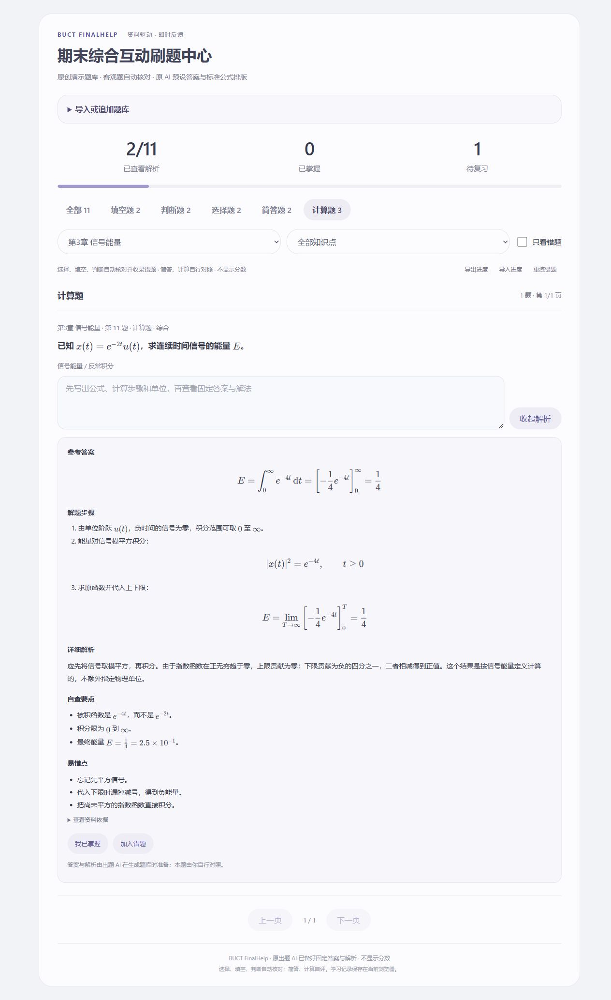

# BUCT FinalHelp

**AI 出题时备好固定答案与规范公式解析，学生直接导入网页练习。**

**[打开固定刷题入口](https://peachjam-thl.github.io/buct-finalhelp/)** · [下载离线入口](docs/index.html) · [示例题库](examples/demo-bank.json)

支持选择、填空、判断、简答和计算五类题。选择/填空/判断按原 AI 给定答案本地核对，答错自动加入错题；简答/计算自行对照。没有分数、模型接口、密钥或在线批改等待。



## 学生怎么用

1. 把课件或笔记交给常用 AI，让它按本 Skill 的格式生成题库和固定解析。
2. 打开固定入口，**选择文件、拖放题库，或粘贴 AI 返回的完整题库/JSON 代码块**。
3. 页面先检查答案、解析、来源、选项、重复题和公式。没有错误即可开始刷题。
4. 有问题时点击 **复制给 AI 的修正说明**，发回原出题 AI；不需要学生改代码或修程序。也可下载修正说明。

学生使用网页无需安装 Python、Node.js 或插件。题库和答题记录只保存在当前浏览器，不上传到网站；建议导出题库和进度作为备份。

点击 **下载离线练习页** 可直接得到带当前课程、数学排版资源和字体的单文件 HTML；没有加载课程时则下载空白通用入口。学习进度单独导出，离线页不会自动包含你的答题记录。

## 分批生成、追加和更新

- **追加到当前课程**：导入后续批次，保留原题与进度，跳过完全重复题。
- **替换当前题库**：导入完整修订版，未修改题目的进度仍保留；只重置修改过的题目。
- 同一课程使用稳定的 `id`；每道题也有稳定 ID。追加遇到同 ID 内容冲突或来源冲突时明确提示，不静默覆盖。
- 导入检查失败不改变当前题库、错题或进度。支持一次选择多个题库文件，每份最多 10 MB，合并后最多 5000 题。
- 浏览器刷新可恢复最近导入题库与进度；浏览器不能自动保存时会提示导出备份。

## 数学公式

题干、选项、参考答案、解题步骤和解析均使用随页面打包的 KaTeX 排版，支持积分上下限、真正的分式、上下标、根号、矩阵、科学计数法等。例如：

$$E=\int_{0}^{\infty} e^{-4t}\,\mathrm{d}t=\frac{1}{4}$$

公式和字体都在单文件内，离线可用，不需要连接 CDN。AI 应输出行内 `\(...\)` 或独立 `\[...\]` 公式；JSON 中反斜杠要转义。不支持的命令、缺失括号等会定位到具体字段，并纳入修正说明。

对 `E=∫₀^∞ e^(-4t)dt=1/4` 这一明确的旧式模式也做了有限的无损展示转换；不会猜测任意混合简写的含义。填空用于判定的普通答案与数学展示可分开设置，排版不会改变可接受答案。

## 给 AI 的使用要求

支持 Skill 的客户端可安装 `skills/buct-finalhelp`。普通聊天场景可把 `SKILL.md` 与 [题库格式](skills/buct-finalhelp/references/bank-format.md) 提交给 AI，让它交付题库文件或完整 JSON 代码块。

> 使用 buct-finalhelp 分析这些资料，按章节和知识点出题。预先写好固定答案、详细解法、自查要点和易错点。公式用规范 LaTeX。交付能直接导入刷题页的题库文件，不需要我运行代码。

> 继续生成下一批，沿用相同课程 ID 和来源 ID，给新增题分配新 ID。我会用“追加到当前课程”导入。

Skill 还会生成 `analysis.md`，记录真实读取范围和“知识点—资料出处—题目”的映射。扫描件需要宿主 AI 有可用的 PDF/OCR 能力；网页不是原始课件上传解析器。题库答案应按原资料复核，不能视为绝对无误。

## 可选：本机安装与构建

```sh
git clone https://github.com/peachjam-thl/buct-finalhelp.git
cd buct-finalhelp
python scripts/install_skill.py
```

已安装时执行 `python scripts/install_skill.py --update`。默认写入 `$CODEX_HOME/skills`，未设置时为 `~/.codex/skills`；也可指定 `--target <skills目录>`。其他 AI 客户端使用其支持的 Skill 目录，不保证所有聊天产品支持目录安装。

生成带示例的离线通用入口：

```sh
python skills/buct-finalhelp/scripts/build_quiz.py --demo examples/demo-bank.json --output private/刷题入口.html
```

生成已装入某门课程的独立页面，或本地启动：

```sh
python skills/buct-finalhelp/scripts/build_quiz.py private/bank.json --output private/index.html
python skills/buct-finalhelp/scripts/serve_quiz.py private/bank.json
```

服务通过系统默认浏览器打开，不指定 Chrome/Edge、不改系统设置。自动验证或无桌面环境可加 `--no-open`。静态文件也可通过 `browser_open.py <index.html>` 在系统默认浏览器打开。

## 检查与边界

```sh
python -m unittest discover -s tests -v
node --test tests/*.test.cjs
```

Python 3.10+，无第三方 Python 运行依赖。KaTeX 浏览器资源已随包提供；Node.js 仅用于开发验证。不是完整 LaTeX 文档编译器，不支持外部宏包或任意 HTML。

仓库包含原创示例，不代表真实课程考试范围，也不代表北京化工大学官方项目或背书。私有资料、课程题库和学习记录默认不上传仓库。验证范围见 [QA.md](QA.md)，第三方许可见 [THIRD_PARTY_NOTICES.md](THIRD_PARTY_NOTICES.md)。MIT License。
